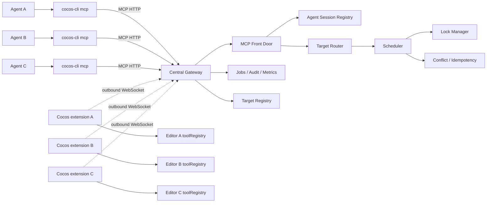
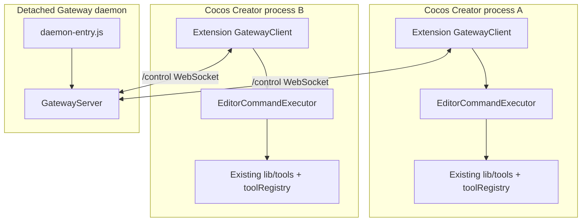
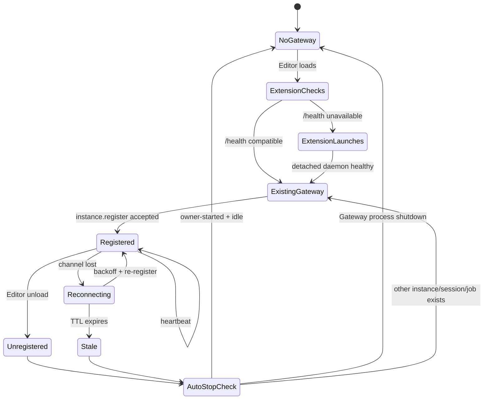
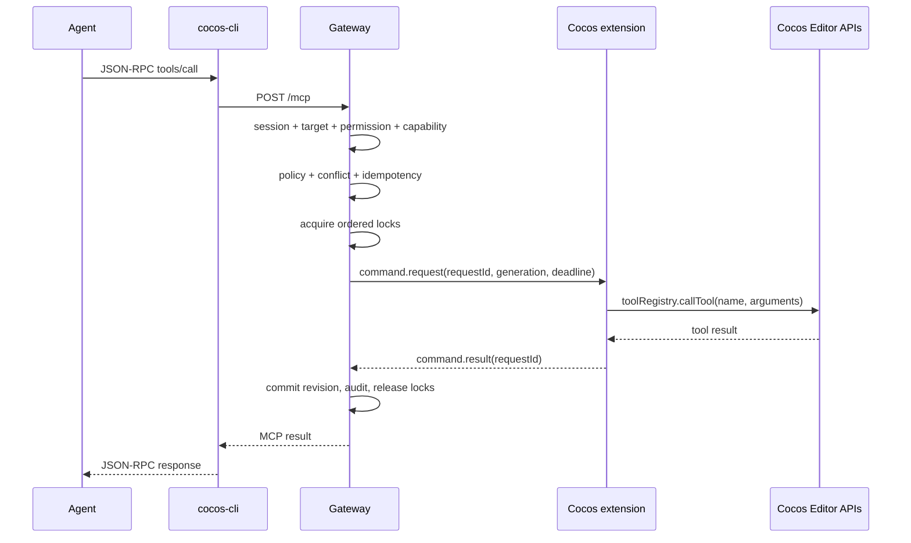

# Cocos CLI Gateway — Architecture

## 1. Mục đích và ranh giới

Kiến trúc này biến `cocos-cli/router` thành một Gateway MCP trung tâm dùng chung cho nhiều agent và nhiều Cocos Creator Editor.

Gateway chịu trách nhiệm:

- MCP ingress và session boundary;
- chọn đúng Editor target;
- permission/capability checks;
- queue, lock, timeout, cancellation;
- conflict/idempotency/job/audit state;
- lifecycle ownership và health.

Cocos extension chịu trách nhiệm:

- kết nối outbound tới Gateway;
- start Gateway detached khi cần;
- đăng ký một Editor instance;
- thực thi tool trong đúng Cocos Editor context.

`cocos-cli` không phải execution engine và không có quyền start/stop Gateway.

## 2. Logical architecture



## 3. Process topology



Gateway và Editor là các process độc lập. Gateway không cần Cocos headless để cung cấp router; Editor process vẫn là nơi có Cocos APIs và tool execution.

## 4. Component ownership

| Component | Ownership | Trách nhiệm |
|---|---|---|
| `bin/cocos-cli.js` | Agent-side | Entry point client-only |
| `bin/funplay-cocos-mcp.js` | Agent-side | MCP stdio bridge, health/target/one-shot calls |
| `GatewayServer` | Gateway | HTTP routes, auth, MCP/control dispatch |
| `McpFrontDoor` | Gateway | MCP initialize/session/tools/resources |
| `TargetRegistry` | Gateway | Editor identities, status, roles, aliases |
| `SessionRegistry` | Gateway | Agent identities, pinning, active requests |
| `Scheduler` | Gateway | Request lifecycle and timeout |
| `LockManager` | Gateway | Atomic multi-resource concurrency control |
| `ConflictDetector` | Gateway | Revision/hash comparison and commit |
| `JobManager` | Gateway | Long-running request status |
| `GatewayClient` | Extension | Lifecycle connection and command receive |
| `EditorCommandExecutor` | Extension | Call existing `toolRegistry` in Editor |
| `process-manager` | Extension-internal | Detached launch, launch lock, ownership state |

## 5. Authority and ownership model



Chỉ extension được phép gọi internal launcher. Gateway ghi `ownerExtensionId`, `ownerInstanceId`, `launchNonce` và `autoStartedByExtension`. Một agent disconnect không được làm Gateway shutdown.

## 6. Request sequence



Nếu deadline hoặc agent cancellation xảy ra sau khi command đã gửi, Scheduler gửi `command.cancel` best-effort cùng control channel; Gateway vẫn là nơi quyết định kết quả, lock release và audit.

## 7. Target routing

Thứ tự resolve:

1. `params.targetId` rõ ràng;
2. target được pin trong agent session;
3. `projectId` và primary writer;
4. nếu còn nhiều candidate: `TARGET_AMBIGUOUS`;
5. không có target online: `TARGET_UNAVAILABLE`/`GATEWAY_UNAVAILABLE` tùy lớp lỗi.

Stateful tools như `open_scene`, selection, input, preview, screenshot và arbitrary script không được load-balance ngẫu nhiên.

Một project có một `primary-writer`. Khi primary unregister/offline/stale, target online kế tiếp được promote. Target read-only không được nhận mutation.

## 8. Concurrency model

Resource names:

```text
project:<projectId>
editor:<editorInstanceId>
scene:<sceneUuid>
asset:<assetUuid-or-path>
file:<path>
preview:<editorInstanceId>
```

Resource được acquire nguyên tử theo thứ tự cố định:

```text
project -> editor -> scene -> asset -> file -> preview
```

Read locks có thể share. Write/exclusive locks serialize. Waiter queue FIFO ngăn read request đến sau vượt qua writer đang chờ. Lease watchdog reclaim lock hết hạn; disconnect release toàn bộ lock theo owner.

Unknown tool được phân loại bảo thủ thành write. Script và interactive tool dùng editor-exclusive lock.

## 9. Security boundary

```mermaid
flowchart LR
    Agent[Agent / CLI] -->|Bearer token if required| Public[MCP + health surface]
    Extension[Cocos extension] -->|Outbound authenticated control| Control[/control WebSocket]
    Public --> Gateway[Gateway policy boundary]
    Control --> Gateway
    Gateway --> Editor[Editor APIs]
```

- Loopback mặc định không yêu cầu token.
- Bind ngoài loopback bắt buộc `COCOS_GATEWAY_AUTH_TOKEN`, trừ khi explicitly opt-in insecure mode trong code.
- `/health` là liveness endpoint; route MCP/control/metrics chịu auth khi token bật.
- Body HTTP tối đa 256 KiB.
- Rate limit có thể bật theo client address.
- CLI không có lifecycle authority nên agent không thể start/stop process qua public command surface.

## 10. Deployment topology

### Local workstation — mặc định

```text
127.0.0.1:8787
  Gateway daemon
  Cocos Editor extension(s)
  cocos-cli process(es)
```

### Remote/local-network mode

Có thể bind Gateway ra interface khác, nhưng phải cấp bearer token và thiết lập network boundary phù hợp. Distributed Gateway, multi-host lock và HA không thuộc bản đầu.

## 11. Design trade-offs

- Giữ tool execution trong Editor giúp tái sử dụng đầy đủ tool hiện tại và Cocos runtime state.
- Centralized locks tránh hai agent mutation đồng thời, đổi lại Gateway là single coordination point.
- Dynamic registry tránh hard-code nhiều Editor, đổi lại target availability phụ thuộc heartbeat.
- In-memory scheduler/session/revision state đơn giản cho local daemon, nhưng chưa phù hợp cho process failover/distributed deployment.
