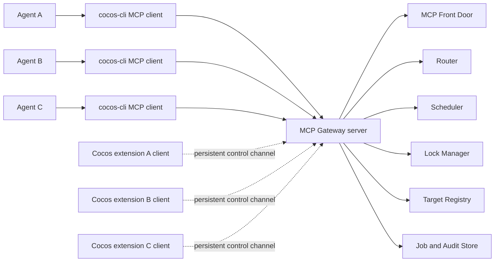

# Cocos CLI Gateway Plan

## 1. Mục tiêu

Xây dựng `cocos-cli/router` thành một MCP Gateway trung tâm để:

- nhiều agent cùng kết nối qua một endpoint MCP;
- điều phối nhiều Cocos Creator Editor;
- định tuyến tool tới đúng project và đúng Editor instance;
- ngăn xung đột khi nhiều agent cùng thao tác;
- tránh deadlock bằng lock manager, queue, timeout và cancellation;
- tái sử dụng các tool hiện có trong `lib/tools/` và phần thực thi trong Cocos extension;
- để Cocos extension chỉ làm client của Gateway, không còn là MCP server public riêng;
- tự động khởi động và quản lý vòng đời Gateway khi Editor mở hoặc đóng.

Gateway là MCP server trung tâm. `cocos-cli` và Cocos extension đều là client của Gateway; tool executor vẫn chạy trong tiến trình Cocos Editor.

## 2. Phạm vi

### In scope

- MCP Gateway dùng chung, chạy dưới dạng detached daemon.
- Cocos extension tự kiểm tra, kết nối và khởi động Gateway khi cần.
- Multi-agent session management.
- Multi-editor target registry.
- Routing theo `targetId`, project và session.
- Tool classification và resource locking.
- Request queue, timeout, cancellation và recovery.
- Conflict detection cho scene, asset và file.
- Health check, capability discovery và audit log.
- CLI cho quản lý router, target và request.

### Không thuộc giai đoạn đầu

- Thay thế hoàn toàn Cocos Creator bằng một Editor headless mới.
- Cho phép hai Editor cùng ghi tự do vào một project.
- Phân tích tĩnh chính xác tác động của arbitrary JavaScript.
- Distributed gateway qua nhiều máy.
- Authentication từ xa phức tạp nếu Gateway chỉ bind localhost.

## 3. Kiến trúc tổng thể



### Gateway dùng chung và vai trò của client

Gateway là một process dùng chung cho nhiều agent và nhiều Editor. Gateway không được expose command start/stop cho `cocos-cli`.

Chỉ Cocos extension đang chạy bên trong Cocos Creator mới có quyền launch Gateway detached. Extension dùng internal launcher/process manager, không gọi một public CLI command để start server.

Agent thường khởi chạy `cocos-cli mcp` dưới dạng stdio client. CLI chỉ forward MCP request/response tới Gateway; CLI không tự start Gateway, route hoặc thực thi tool:

```text
Agent -> stdio -> cocos-cli -> MCP Gateway -> Cocos extension -> Editor APIs
```

Cocos extension cũng không nhận request MCP trực tiếp từ agent. Extension mở một control channel outbound tới Gateway, đăng ký Editor instance và nhận lệnh đã được Gateway điều phối.

Các agent kết nối gián tiếp tới Gateway:

```text
http://127.0.0.1:8787/mcp
```

CLI one-shot vẫn có thể cung cấp cho người dùng:

```bash
cocos-cli targets list
cocos-cli call get_hierarchy --target game-editor
```

### Vòng đời Gateway và extension

Extension phải thực hiện quy trình sau khi Cocos Editor khởi động:

1. Đọc địa chỉ Gateway từ config hoặc environment.
2. Gọi health endpoint và kiểm tra Gateway protocol/version.
3. Nếu Gateway còn sống, mở control channel và đăng ký instance.
4. Nếu Gateway không sống, extension gọi internal Gateway launcher để khởi động Gateway detached.
5. Chờ health check thành công, sau đó đăng ký instance.
6. Gửi heartbeat định kỳ trong suốt vòng đời Editor.

`ensure` phải có single-flight/lock ở cấp máy để nhiều Editor khởi động cùng lúc không tạo nhiều Gateway process. Process được start detached, không phụ thuộc stdin/stdout của Cocos Editor và không bị kill khi Editor extension host kết thúc.

Khi Editor đóng:

1. Extension gửi `instance.unregister` với `editorInstanceId` và session token.
2. Gateway loại instance khỏi Target Registry ngay lập tức.
3. Nếu unregister thất bại, heartbeat TTL giúp Gateway tự loại instance stale.
4. Gateway kiểm tra số Editor instance, agent session và job đang chạy.
5. Chỉ khi không còn instance, agent session hoặc job cần thiết, Gateway mới tự shutdown nếu nó được auto-start bởi extension và `autoStopWhenIdle=true`.

Extension không tự ý kill một Gateway process đang được dùng chung. Nếu còn Editor instance khác, extension chỉ unregister instance của nó và không làm gì thêm. Gateway có thể phát event/log `instance.disconnected` cho các client cần biết.

`cocos-cli` không có quyền start hoặc stop Gateway. Nếu Gateway không sống, CLI chỉ trả `GATEWAY_UNAVAILABLE` và yêu cầu người dùng mở một Cocos Editor có extension hoạt động. Việc tự shutdown chỉ được Gateway thực hiện sau lifecycle event từ extension và khi process đó thuộc ownership của extension.

### Startup authority và ownership

- Extension là startup authority duy nhất.
- Gateway phải được spawn bằng internal launcher của extension, ở chế độ detached.
- `cocos-cli` chỉ được phép kết nối tới Gateway đã tồn tại.
- `cocos-cli router start`, `cocos-cli router ensure`, `cocos-cli router stop` không được tồn tại trong public command surface.
- Gateway lưu `ownerExtensionId`, `ownerInstanceId` và `launchNonce` để biết process nào được extension khởi động.
- Gateway chỉ auto-stop khi owner extension đã unregister, không còn Editor instance/agent/job và policy `autoStopWhenIdle` được bật.
- Gateway không được tắt chỉ vì một agent hoặc một CLI client disconnect.
- Các command debug trực tiếp phải nằm ngoài package/public CLI và chỉ được bật trong development build.

## 4. Target Registry

Mỗi Editor phải có một target riêng.

```json
{
  "id": "game-editor",
  "projectId": "sha256-project-path",
  "editorInstanceId": "random-process-instance-id",
  "connectionId": "gateway-connection-id",
  "transport": "websocket",
  "status": "online",
  "role": "primary-writer",
  "cocosVersion": "3.8.x",
  "capabilities": ["scene", "asset", "preview", "screenshot"],
  "lastSeenAt": "2026-07-31T00:00:00.000Z"
}
```

### Định danh

- `projectId`: định danh ổn định từ đường dẫn project.
- `editorInstanceId`: định danh riêng cho mỗi process Editor.
- `targetId`: tên thân thiện do Gateway hoặc người dùng đặt.

Code hiện tại chỉ có `projectIdentity` dựa trên project path. Khi hỗ trợ nhiều Editor cùng một project, cần bổ sung `editorInstanceId`; nếu không, các instance có thể bị attach nhầm vào cùng listener.

### Đăng ký và health check

Gateway cần hỗ trợ đăng ký dynamic từ extension:

```text
instance.register
  -> instanceId, projectId, editorVersion, capabilities, pid, metadata

instance.heartbeat
  -> instanceId, connectionId, generation, currentState

instance.unregister
  -> instanceId, reason, lastRequestId
```

Control channel phải là bidirectional và outbound từ extension tới Gateway. WebSocket là transport ưu tiên; transport cần được trừu tượng hóa để sau này có thể dùng IPC hoặc streamable HTTP.

Sau khi đăng ký, Gateway gửi lệnh tới extension qua cùng connection:

```text
Gateway -> extension: command.request { requestId, tool, arguments, deadline }
extension -> Gateway: command.result { requestId, result | error }
```

`requestId`, `generation` và deadline phải được giữ nguyên trong toàn bộ tuyến Agent -> CLI -> Gateway -> extension. Extension không tự chọn target và không tự xử lý conflict; nó chỉ thực thi lệnh trong Editor context rồi trả kết quả hoặc lỗi về Gateway.

CLI chỉ hỗ trợ các thao tác client/read-only với Gateway đang sống:

```bash
cocos-cli targets list
cocos-cli target health game-editor
```

Target trong production được đăng ký động bởi extension. `target add/remove` không thuộc normal CLI flow; nếu cần test static target, đó là API nội bộ của Gateway và không được dùng để khởi động process.

Gateway định kỳ kiểm tra `/health` của chính Gateway và heartbeat/control channel của từng extension. Target mất heartbeat sẽ chuyển sang `offline`, không nhận request mới và được loại khỏi routing sau TTL.

Mỗi connection cần có `generation` hoặc `connectionId` để một Editor restart không thể gửi unregister nhầm cho connection mới của chính instance đó.

## 5. Routing policy

Thứ tự chọn target:

1. `targetId` được truyền rõ trong request.
2. Target được pin trong session của agent.
3. Primary target của project.
4. Nếu còn nhiều target phù hợp thì trả lỗi `TARGET_AMBIGUOUS`, không tự chọn ngẫu nhiên.

Không load-balance các thao tác stateful như:

- `open_scene`;
- `set_selection`;
- `execute_javascript`;
- `execute_editor_script`;
- `execute_scene_script`;
- preview, input và screenshot.

Với một project, chỉ nên có một `primary-writer`. Các Editor còn lại mặc định là `read-only` hoặc phải được cấp quyền writer rõ ràng.

## 6. Agent sessions

Mỗi agent có một session riêng ở Gateway:

```text
Agent A -> Gateway session A
Agent B -> Gateway session B
```

Session cần lưu:

- `agentId`;
- MCP session ID;
- target đang được pin;
- request đang chạy;
- lock đang giữ;
- deadline và cancellation state;
- quyền read/write;
- audit metadata.

`enableSessions` của Editor server hiện tại chỉ xác thực `Mcp-Session-Id`; nó không tạo isolation, lock hoặc state riêng cho agent. Vì vậy việc điều phối phải do Gateway thực hiện.

Gateway có thể duy trì một upstream MCP connection tới mỗi Editor, trong khi downstream session của từng agent vẫn tách biệt.

## 7. Tool policy metadata

Mỗi tool cần metadata để Scheduler biết cách chạy.

```js
{
  name: 'open_scene',
  access: 'write',
  scope: 'editor',
  locks: ['editor.ui', 'project.scene'],
  cancellable: true,
  timeoutMs: 30000,
  idempotent: false
}
```

### Các nhóm tool

- `read`: chỉ đọc dữ liệu, có thể chạy song song nếu thật sự không làm thay đổi Editor state.
- `write`: sửa file, scene, asset hoặc project configuration.
- `editor-state`: selection, active scene, focus và panel state.
- `interactive`: mouse, keyboard, screenshot và Electron window.
- `script`: JavaScript arbitrary, mặc định chạy exclusive trên Editor.
- `long-running`: build, preview, diagnostics và các job có thời gian dài.

Các tool `execute_javascript`, `execute_editor_script` và `execute_scene_script` phải mặc định giữ exclusive lock vì Gateway không thể biết trước script sẽ tác động tới resource nào.

## 8. Lock Manager

### Resource locks

```text
project:<projectId>
editor:<editorInstanceId>
scene:<sceneUuid>
asset:<assetUuid>
file:<absolutePath>
preview:<editorInstanceId>
```

Ví dụ:

```text
get_hierarchy
  -> read: editor:<id>, scene:<uuid>

open_scene
  -> write: editor:<id>, project:<id>

write_file
  -> write: project:<id>, file:<path>

execute_javascript
  -> exclusive: editor:<id>
```

### Quy tắc chống deadlock

- Acquire toàn bộ lock của request theo một thao tác nguyên tử.
- Không giữ một phần lock trong khi chờ lock khác.
- Nếu cần thứ tự, dùng thứ tự cố định: `project -> editor -> scene -> asset -> file`.
- Mỗi lock có timeout và lease.
- Agent disconnect thì tự động release lock.
- Watchdog giải phóng lock khi owner chết hoặc quá hạn.
- Queue phải có fairness, tránh agent chờ vô hạn.
- Không retry mutation nếu chưa có `idempotencyKey`.

## 9. Scheduler và request lifecycle

Mỗi request đi qua các bước:

1. Xác thực session và quyền.
2. Resolve `targetId`.
3. Kiểm tra target health và capabilities.
4. Tạo request context gồm `requestId`, deadline, agent và target.
5. Tính resource locks từ tool policy và arguments.
6. Đưa request vào queue phù hợp.
7. Acquire toàn bộ lock hoặc trả `LOCK_TIMEOUT`.
8. Forward MCP request tới Editor.
9. Theo dõi timeout, cancellation và disconnect.
10. Release lock, ghi audit log và trả kết quả.

Các request read-only có thể chạy song song. Mutation trên cùng project/editor phải chạy tuần tự.

## 10. Conflict detection

Lock ngăn xung đột đồng thời, nhưng vẫn cần phát hiện dữ liệu đã cũ.

Gateway nên lưu revision trước mutation:

- file: hash hoặc mtime;
- scene: asset revision hoặc content hash;
- asset: UUID, mtime và metadata hash;
- Editor target: generation/state counter.

Trước khi commit, kiểm tra revision vẫn khớp. Nếu đã thay đổi, trả:

```text
CONFLICT
STALE_EDITOR_STATE
```

Các mutation retry được yêu cầu truyền `idempotencyKey` để tránh chạy hai lần.

## 11. MCP surface của Gateway

Gateway giữ nguyên tên các tool Cocos hiện tại và thêm `targetId` ở lớp ngoài. `targetId` được Gateway loại bỏ trước khi forward xuống Editor.

Nên bổ sung các tool quản trị:

```text
cocos_targets
cocos_target_health
cocos_lock_status
cocos_job_status
cocos_cancel
```

Resources nên namespace theo target:

```text
cocos://targets/<targetId>/logs
cocos://targets/<targetId>/state
cocos://projects/<projectId>/locks
```

## 12. Cấu trúc code đề xuất

```text
lib/gateway/
├── gateway-server.js
├── mcp-front-door.js
├── target-registry.js
├── editor-connection.js
├── extension-protocol.js
├── lifecycle-manager.js
├── process-manager.js
├── router.js
├── scheduler.js
├── lock-manager.js
├── tool-policies.js
├── request-context.js
├── conflict-detector.js
└── job-manager.js

lib/extension/
├── gateway-client.js
├── instance-registration.js
└── editor-command-executor.js

bin/
└── cocos-cli.js
```

Các tool hiện tại trong `lib/tools/`, `browser.js` và `scene.js` tiếp tục chạy trong Cocos extension. Gateway chỉ forward lệnh tới `editor-command-executor`; không chuyển tool execution sang CLI.

`lib/server.js` hiện tại đang là MCP server chạy trong Editor. Khi migration, nó trở thành legacy adapter hoặc được thay bằng `extension-protocol.js`; extension không expose MCP endpoint riêng cho agent nữa.

Gateway daemon entrypoint nằm trong `lib/gateway/daemon-entry.js` và chỉ được internal launcher của extension gọi. Không publish daemon entrypoint này như một `cocos-cli` subcommand.

## 13. Lộ trình triển khai

### Phase 0 — Lifecycle và control channel

- Implement `GET /health` cho Gateway với `serverInstanceId`, PID, ownership mode và số lượng instance/agent/job đang hoạt động.
- Implement internal extension launcher với process lock/single-flight.
- Start Gateway detached, không phụ thuộc stdin/stdout của Editor.
- Từ chối hoặc không cung cấp public CLI command có khả năng start/stop Gateway.
- Implement extension Gateway client.
- Implement `instance.register`, `instance.heartbeat` và `instance.unregister`.
- Implement reconnect với exponential backoff.
- Implement stale instance cleanup bằng heartbeat TTL.
- Implement auto-stop khi Gateway được extension auto-start và không còn instance, agent session hoặc job.
- Lưu ownership gồm `ownerExtensionId`, `ownerInstanceId` và `launchNonce`.

### Phase 1 — Gateway MCP cơ bản

- Tạo MCP front door tại Gateway.
- Forward `tools/list` và `tools/call` qua control channel tới một extension.
- Thêm stdio bridge `cocos-cli mcp` cho agent.
- Thêm CLI `mcp`, `targets list`, `target health` ở chế độ client-only.
- Giữ nguyên schema và response của tool hiện tại.

### Phase 2 — Multi-editor

- Implement Target Registry.
- Thêm `editorInstanceId`.
- Dynamic registration, heartbeat và capability discovery.
- Routing bằng `targetId` và sticky session.
- Xử lý target offline và ambiguous target.
- Chỉ cho phép một primary writer trên mỗi project.

### Phase 3 — Multi-agent

- Session registry cho agent.
- Agent permissions.
- Request context và audit metadata.
- Central cancellation và disconnect cleanup.

### Phase 4 — Concurrency control

- Tool policy metadata.
- Lock Manager.
- Scheduler và per-target/per-project queue.
- Timeout, lease, watchdog và fairness.
- Read parallelism, mutation serialization.

### Phase 5 — Conflict và reliability

- Revision/hash checking.
- Idempotency key.
- Job manager cho build/preview/diagnostics.
- Recovery khi Editor hoặc Gateway restart.
- Structured error codes.

### Phase 6 — Production hardening

- Authentication/token nếu bind ngoài localhost.
- Rate limiting và request size limit.
- Persistent target configuration.
- Metrics, tracing và lock diagnostics.
- Tài liệu vận hành và migration guide.

## 14. Test bắt buộc

- Hai agent cùng đọc một scene.
- Hai agent cùng sửa một scene.
- Một agent đọc trong khi agent khác ghi.
- Hai mutation trên cùng file.
- Hai mutation trên hai file khác nhau.
- Agent disconnect khi đang giữ lock.
- Hai extension khởi động cùng lúc chỉ tạo một Gateway process.
- Extension kết nối được với Gateway đang sống mà không tạo process mới.
- Extension cuối cùng đóng thì Gateway auto-start tự shutdown khi không còn agent/job.
- Extension không phải cuối cùng đóng thì Gateway vẫn sống và các instance khác không bị ảnh hưởng.
- Gọi command start/stop Gateway từ `cocos-cli` bị từ chối hoặc không tồn tại.
- Unregister thất bại nhưng heartbeat TTL vẫn cleanup được instance.
- Extension reconnect sau khi control channel bị đứt.
- Gateway restart làm các extension re-register được.
- Request timeout trong Editor.
- Editor offline giữa request.
- Hai Editor cùng mở một project.
- Target bị mất và xuất hiện lại.
- Hai request giữ lock chéo để xác nhận không deadlock.
- Retry cùng `idempotencyKey`.
- Request không có `targetId` nhưng có nhiều target phù hợp.

## 15. Tiêu chí hoàn thành bản đầu

- Nhiều agent kết nối được tới cùng Gateway.
- Gateway định tuyến được ít nhất hai Editor khác nhau.
- Không có hai mutation chạy đồng thời trên cùng Editor.
- Lock timeout và cancellation hoạt động.
- Editor disconnect không để lại lock mồ côi.
- Request ambiguous không bị route ngẫu nhiên.
- Các tool hiện tại vẫn giữ nguyên tên và schema.
- Có log cho agent, target, request, lock và kết quả.
